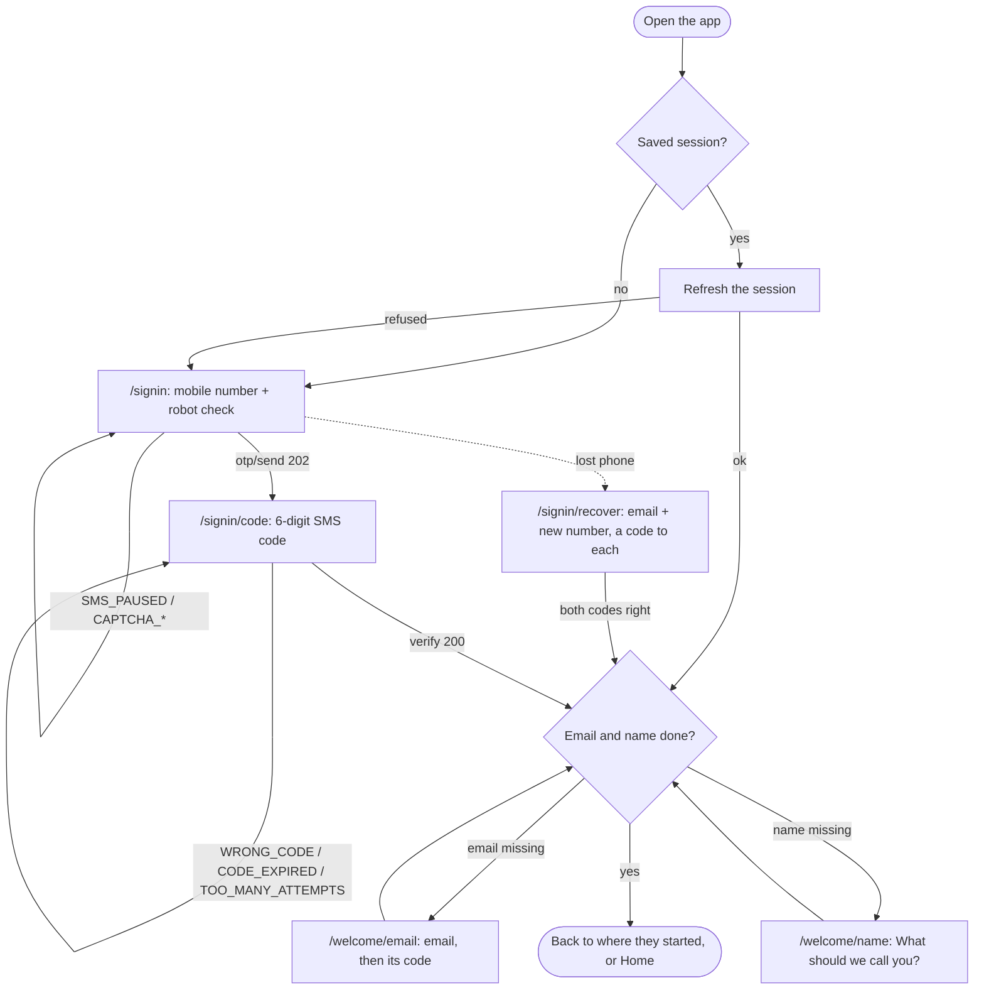
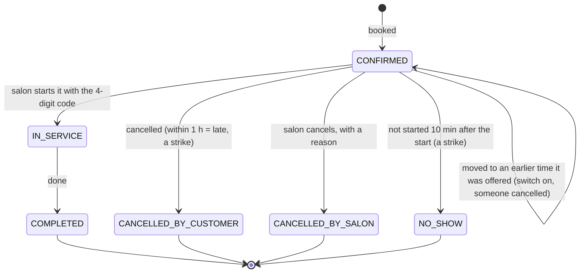
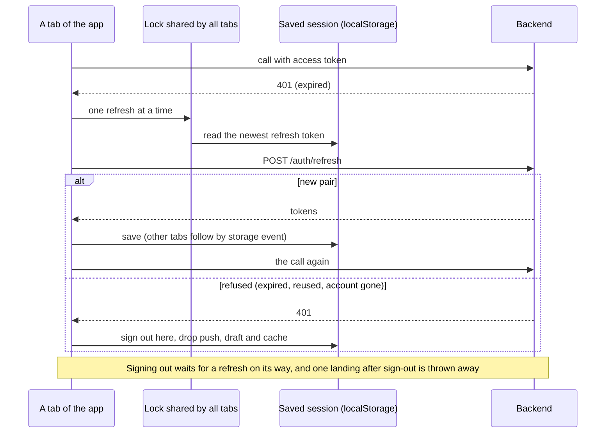

# Clozest — customer app

The app customers use to find a salon near them and book a time. It is a mobile-first web app (it can be
added to the phone's home screen) and talks only to [apni-dukan-backend](https://github.com/Premanshu-jha/apni-dukan-backend).

Home has category tabs like Swiggy's Food and Instamart: **Salon** works today; **Kirana** and **Services** show
"Coming soon". Shop owners and the field team use separate apps (partner and admin), not this one.

## Run it on your laptop

You need Node 22 and the backend running (on your laptop at `http://localhost:8080`, or on Railway).

```bash
npm install
cp .env.example .env.local     # then edit the two values
npm run dev                    # http://localhost:5173
```

| Setting | What it is | Example |
| --- | --- | --- |
| `VITE_API_URL` | The backend's address, no trailing slash | `http://localhost:8080` or `https://apni-dukan-backend-production.up.railway.app` |
| `VITE_TURNSTILE_SITE_KEY` | Cloudflare Turnstile **site** key (public). Leave empty when the backend has no `TURNSTILE_SECRET_KEY` | `0x4AAAAAAA…` |
| `VITE_SUPPORT_EMAIL` | Where customers write for help (Profile, and "No salons near you yet"). Default `support@apnidukan.in` | `support@apnidukan.in` |

All are public values baked into the page at build time. No secret ever goes in this app.

The backend must allow this app's address in `CORS_ALLOWED_ORIGINS` (it already allows `http://localhost:5173`).

| Command | Does |
| --- | --- |
| `npm run dev` | Dev server with hot reload |
| `npm run typecheck` | TypeScript check |
| `npm run lint` | oxlint |
| `npm test` | Unit tests (Vitest) |
| `npm run e2e` | End-to-end tests (Playwright): a real browser drives the app against a fake backend |
| `npm run build` | Type-check and production build into `dist/` |
| `npm run icons` | Make the PNG icons from `public/icon.svg` (commit them) |

CI runs type-check, lint, unit tests, build, the end-to-end tests, the security-headers check (Caddy), `npm audit`
(high and critical) and a gitleaks secret scan on every pull request. Dependabot proposes npm and GitHub Actions
updates weekly.

### Tests

Every situation a customer can run into is listed in [`docs/scenarios.md`](docs/scenarios.md): the journey, what
the backend answers, what the screen shows, and which test proves it. New work adds or updates rows there, and
reviews walk the list against the code.

- **Unit tests** (`src/**/*.test.ts`): India time, money, phone numbers, the profile steps, the booking draft, and
  the API client (one shared refresh, the newest saved token, a refresh landing after sign-out, busy retry, error
  codes).
- **End-to-end tests** (`e2e/`): Playwright on a phone-sized Chromium, against `e2e/mockApi.ts`, a fake backend
  whose answers follow the backend's records and error codes (`.env.e2e` points the app at it). Journeys: sign-up
  to booking, blocked location, a time taken by someone else, move and cancel, a late cancel, messages, sign-out
  and the next person, two tabs sharing one session, a failed "sign out everywhere", a removed service in a saved
  draft. A failed run in CI keeps its traces as an artifact.

## Screens

Everything needs sign-in, because the backend's salon endpoints need a signed-in session. The guards in
`src/app/guards.tsx` send people to the right step.

| Route | Screen | Backend calls (`/api/v1/…`) |
| --- | --- | --- |
| `/signin` | Mobile number + robot check | `POST auth/otp/send` |
| `/signin/code` | 6-digit SMS code, resend after 30 s | `POST auth/otp/verify` |
| `/signin/recover` | Lost phone: email + new number, a code to each | `POST auth/recover/start`, `auth/recover/complete` |
| `/welcome/email` | Step 2 of 3: email and its code | `POST auth/email/send-code`, `auth/email/verify` |
| `/welcome/name` | Step 3 of 3, last: "What should we call you?" | `PATCH auth/me` |
| `/` | Home: category tabs; Salon tab = location, then salons within 2 km, 30 at a time ("Show more salons") | `GET salons?lat&lng[&afterDistance&afterId]` |
| `/salons/:id` | Salon: photo, address, services to tick, opening hours | `GET salons/{id}`, `salons/{id}/services` |
| `/salons/:id/book` | Day chips (7 days) and free times | `GET salons/{id}/availability?services&date` |
| `/salons/:id/confirm` | Summary and Book now | `POST bookings` (with `Idempotency-Key`) |
| `/bookings` | Upcoming / Past | `GET me/bookings?when=` |
| `/bookings/:id` | Start code, arrive-by time, services, Move, Cancel, notifications offer | `GET bookings/{id}`, `POST bookings/{id}/cancel` |
| `/bookings/:id/move` | New day and time | `POST bookings/{id}/reschedule` |
| `/notifications` | Messages: newest first, unread marked, tap to open the booking, Mark all read, Show older | `GET me/notifications?app=customer`, `POST me/notifications/read` |
| `/profile` | Name, mobile, email, notifications switch, help email, sign out, sign out everywhere | `PATCH auth/me`, `POST auth/logout`, `auth/logout-all` |
| `/profile/email` | Change email (SMS code first when the old email is verified) | `POST auth/email/change-phone-code`, `auth/email/send-code`, `auth/email/verify` |
| `/profile/delete` | Delete account with an SMS code | `POST auth/me/delete-code`, `auth/me/delete` |

## Flows

### Sign-up and sign-in

Who goes where: the route guards (`src/app/guards.tsx`) and `nextAfterSignIn` (`src/features/auth/flow.ts`).



### Finding a salon and booking

`LocationGate`, `SalonList`, `SalonPage`, `BookTime`, `ConfirmBooking`. Every backend answer on Book has its own
branch; the Idempotency-Key in the draft means a retried tap never books twice.

```mermaid
flowchart TD
  home([Home: Salon tab]) --> loc{Location?}
  loc -- "not asked yet" --> explain[Why we need it → Allow location]
  explain --> loc
  loc -- blocked or off --> guide[Step-by-step guide → Try again]
  guide --> loc
  loc -- outside India --> india[Clozest works only in India]
  loc -- ok --> list[Salons within 2 km]
  list -- none --> empty[No salons near you yet → Let us know]
  list --> salon["/salons/:id: tick services"]
  salon --> time["/salons/:id/book: day chips, free times"]
  time --> confirm["/salons/:id/confirm: Book now + Idempotency-Key"]
  confirm -- 201 --> booked([Booking with start code])
  confirm -- SLOT_TAKEN --> time
  confirm -- PROFILE_INCOMPLETE --> step[Missing sign-up step] --> confirm
  confirm -- "BOOKING_BLOCKED / TOO_MANY_BOOKINGS / TOO_MANY_CHANGES / OVERLAPS_YOUR_BOOKING" --> msg[Banner: the reason, e.g. when booking opens again]
  confirm -- "network timeout, retried" --> same[Same key: never two bookings]
```



### A booking's life

What the customer sees on `/bookings/:id` (`BookingDetail`). Move is offered only while `canMove` is true (more than
1 hour to go and the salon taking changes); Cancel while `canChange` is true.



### Staying signed in (several tabs)

`src/api/client.ts` and `src/store/session.ts`.



## How it works

### Folders

```
src/
  app/          routes (App.tsx), guards, shell with the bottom bar
  api/          client.ts (fetch, refresh, retries), errors.ts, types.ts, one file per backend area
  features/     auth, home, location, salon, bookings, profile — one folder per part of the app
  components/   Button, Field, Card, Banner, Sheet, Chip, CodeInput, Turnstile
  store/        session, location, booking draft (Zustand)
  lib/          India time, money, phone, storage, device name, config
public/         sw.js (push notifications), manifest, icon
```

### Sign-in and the session

- Sign-up order: phone code → email code → name (asked last). `missingSteps()` in `store/session.ts` decides what
  is still needed; the backend refuses bookings with `403 PROFILE_INCOMPLETE` until all three are done.
- The **access token** (15 minutes) is kept in memory only. The **refresh token** and the user are saved in
  `localStorage` (`ad.session`) so a reload keeps the person signed in.
- `api/client.ts`: any 401 → one refresh → the request again. Requests that hit an expired token at the same time
  share one refresh. A refused refresh signs the person out; a network blip doesn't.
- `SERVICE_BUSY` (503) → wait `Retry-After` (at most 5 s) and try once more, only for reads and for calls with an
  `Idempotency-Key`.
- **Several tabs:** all tabs share the saved refresh token. A refresh takes a lock shared by the tabs
  (`navigator.locks`) and reads the newest saved token inside it, and each tab follows the others through `storage`
  events. Without this, a second tab would send an already-swapped token, which the backend treats as theft and
  answers by signing the person out everywhere (`REFRESH_TOKEN_REUSED`).
- **Signing out while a refresh is on its way:** sign-out waits for it, and a refresh that still lands afterwards
  is thrown away (its new token is signed out too), so the session never comes back by itself.
- **When the backend ends the session** (expired, signed out everywhere, account deleted on another device), this
  browser drops its notification subscription, the booking draft, cached data and the saved return path.
- A device name ("Chrome on Android · 4f2a") is made once and sent with sign-in and refresh.
- Known trade-off for now: a refresh token in `localStorage` can be read by a script injected into the page. Before
  launch it can move to an HttpOnly cookie (needs a small backend change).

### Location and nearby salons

- Location comes from the phone only; there is no pincode option. Before the browser's Allow/Block prompt the app
  explains why. If location is blocked or off, a guide shows the steps for Android, iPhone or a computer.
- The location is saved on the phone (`ad.location`) and shown as "Near your current location · ±30 m · Update".
- Accuracy worse than 1 km (usual on laptops) shows a warning that results may be off.
- The backend returns approved salons within 2 km, nearest first, 30 at a time (found by a map index, so a dense
  city is as fast as a quiet one). "Show more salons" asks for the next 30 after the last one's distance and id,
  until a shorter page comes back. None → "No salons near you yet" with a "Let us know" email link (to
  `VITE_SUPPORT_EMAIL`).

### Booking

- The draft (salon, services, day, time, idempotency key) is saved on the phone (`ad.draft`), so a reload keeps it.
- Changing the services clears the chosen time (a different length of booking needs a different slot).
- Book sends an `Idempotency-Key`; a retried tap never makes two bookings. A new key is made after any final answer.
- A draft saved on an earlier day keeps its services but drops a day or time that has passed.
- `IDEMPOTENCY_KEY_REUSED` (an earlier try whose answer never arrived may have booked) → "Check My bookings", and a
  new key for the next try.
- `SLOT_TAKEN` (booking or moving) refreshes that salon's free times, then → back to the time screen with "Someone just booked that time". `TOO_MANY_BOOKINGS` (2 upcoming) links
  to My bookings. Other errors show the backend's own message.
- All times are shown in India time (`lib/ist.ts`), whatever zone the phone is set to.
- Move is hidden within 1 hour of the start (`canMove` from the backend). Cancelling within 1 hour warns that it
  counts as a late cancel.
- **Free times stay current:** while a list of free times is on screen it is asked for again every 30 s, and at once
  when a message arrives, so a time someone just took goes and one just freed appears without a reload. A refresh
  that fails keeps the times with a note; a picked time that got taken is cleared with "That time isn't free any
  more".
- **"Tell me if an earlier time opens":** a switch on Confirm (off by default, kept in the draft, not shown for a
  booking within the hour; sent as `earlierAlert` only when on, so an older backend isn't refused) and on the
  booking page while it can still move (`PUT /bookings/{id}/earlier-alert`). When someone's cancel or move frees an
  earlier time that day that suits the booking, the backend sends a `BOOKING_EARLIER_SLOT` message whose link is
  `/bookings/{id}?earlier=<start>`. The booking page then shows "An earlier time opened" with one button, "Move to
  …" (the usual move): first to move gets it; if someone else was first, "Someone else took … first" and a way to see
  other times; a time that passed, or is now too soon for the salon, says so. A link for a time the booking is
  already at, or a broken one, shows nothing extra. Needs backend V33 (PR #44).

### My bookings and busy salons

- **Past bookings** come 30 at a time, latest first, with "Show more bookings": the next page starts after the last
  booking's `startsAt` and `id`, sent back exactly as received (keyset pages; the backend reads times to the
  microsecond). Upcoming bookings are a few at most and come in one answer (the backend refuses a cursor there). A
  failed page or a tap while offline keeps the list and says so; focus moves to the first new booking (or the count);
  `aria-busy` while loading; cards far off screen aren't drawn (`content-visibility`).
- **Bounded refreshes:** a refresh of a paged list (a booking changed, coming back to the app) asks every loaded page
  again, one after the other, so the pages stay joined with nothing missing or twice; each is a 304 when unchanged.
  At most 10 pages are loaded (300 past bookings, 300 messages), then a note says so — for past bookings only when
  the page after the cap (asked once) isn't empty, so exactly 300 shows no note. TanStack's `maxPages` isn't
  used: it would drop the latest page from the top, and the backend has no "page before" to bring it back.
- **Too many salon reads:** past 60 salon pages, service lists and free-time checks a minute the backend answers 429
  with `Retry-After`. The salon page, Confirm and the free times say "Too many tries — wait a minute, then try
  again." Nothing retries at once (a 4xx is final; the client repeats only `SERVICE_BUSY`), and a failed refresh
  of a salon page already on screen keeps it with a note. Free times on screen are the one exception: they are
  asked again every 30 s whatever the last answer was (2 reads a minute, far below the 60), so a 429 there clears
  on its own once the minute is over.
- **Busy backend:** `SERVICE_BUSY` (503, `Retry-After: 5`) is tried once more by the client after `Retry-After`, then
  by the query twice more, each after `Retry-After` too.

### Notifications

- `public/sw.js` shows the backend's Web Push messages (`{type, title, body, url}`) and opens the app on tap, only on
  this app's own pages.
- Offered once after a booking, and as a switch on Profile. Needs the backend's VAPID keys; without them the app says
  notifications aren't set up. On iPhone, notifications work only after "Add to Home Screen".
- Signing out or deleting the account turns them off for this browser first. After every sign-in the browser's
  subscription is sent again, which moves it to the person now signed in (one browser never gets another
  person's messages).
- **In-app messages:** the bell on Home shows the unread count (checked every minute and when the app comes back
  into view). The Messages screen lists the same messages the backend sends as notifications, so nothing is lost
  if notifications are blocked. Tapping one marks it read and opens its booking (only this app's own pages).
  When a push arrives while the app is open, the service worker tells the page, which refreshes the bell, the
  bookings and any free times on screen at once. Needs the backend's `GET /me/notifications` (backend PR #22).
- An open booking refreshes every 30 s while it can still change (booked or in progress), then stops.

## Deploying

Railway (a service that builds from `main`). `railway.json` picks Railpack, which sees a Vite site
(no `start` script), runs `npm run build` and serves `dist/` with Caddy, using this repo's `Caddyfile` instead of its
default: every address that isn't a file gets `index.html` (single-page app), `/health` answers 200, and every answer
carries the security headers. Keep the service's Start Command empty in Railway's settings: a start command turns
Caddy (and the headers) off. Set `VITE_API_URL` and `VITE_TURNSTILE_SITE_KEY` as the service's variables (they are
read at build time), optionally `PHOTO_ORIGIN` (default `https://*.r2.cloudflarestorage.com`, where signed photo
links point). Then add the site's address to the backend's `CORS_ALLOWED_ORIGINS`.

### Security headers

`security-headers.ts` works them out from the build's variables; the build writes them to
`dist/security-headers.caddy`, which the `Caddyfile` imports, and `vite preview` (the end-to-end tests) sends the same.

| Header | Value |
| --- | --- |
| `Content-Security-Policy` | `default-src 'self'`; scripts from the site (plus `https://challenges.cloudflare.com` when the Turnstile key is set, also its frame); API calls only to `VITE_API_URL`; images from the site, `data:`, `blob:` and `PHOTO_ORIGIN`; styles allow inline (the Turnstile widget); no plugins; `frame-ancestors 'none'` (never inside another site's frame) |
| `Strict-Transport-Security` | `max-age=63072000; includeSubDomains` |
| `Referrer-Policy` | `strict-origin-when-cross-origin` |
| `X-Content-Type-Options` | `nosniff` |
| `Permissions-Policy` | `geolocation=(self)` (salons near you); camera, microphone, payment and the rest off |

CI's `headers` job builds as for production, starts Caddy with the `Caddyfile` (the build at `/app/dist`, as on
Railway) and checks every header on the app, a deep link, `sw.js`, the manifest and the offline page
(`scripts/check-headers.mjs`). The dev server sends none (hot reload needs inline scripts).

### Installing and offline

`public/manifest.webmanifest` lists the SVG icon and PNGs (192, 512, maskable 512) plus `apple-touch-icon.png` for
iPhone, all made from `public/icon.svg` by `npm run icons` (sharp); commit the PNGs after changing the SVG.
`public/sw.js` keeps a small offline page (`offline.html`, its CSS and the icon): opening the app without a
connection shows "You're offline" with "Try again" instead of the browser's error. Nothing else is cached. A new
version of `sw.js` waits after installing; the app shows "New version available — Reload" and only that button
switches over. Change `OFFLINE_CACHE` in `sw.js` when the offline page changes.

## Changelog

### 0.12.0 — 2026-11-11

Needs the backend with `POST /auth/me/phone/send-code` and `POST /auth/me/phone`.

- **Change your mobile number** (Profile → Mobile → Change): a code to the new number and a second one to your email. The same
  account moves to the new number (bookings and history stay); other devices are signed out, this one carries on. A
  number that already has an account is refused.
- A refresh on its way while the number changes waits for the new tokens instead of signing out (`replacingSession`).
- A lost answer after the change went through: the sign-in screen says the number probably moved and fills it in (an
  old-number sign-in would make a new, empty account). This device's notifications are registered again after the
  change. The "number is now …" notice shows once.
- Scenarios 266–279 in `docs/scenarios.md`; end-to-end journeys in `e2e/change-phone.spec.ts`.

### 0.9.0 — 2026-11-10

Needs the backend with V34–V36 (ratings, salon cards, come-back reminders).

- **Salon cards** show the rating ("★ 4.6 (12)", or "New" until 5 ratings), the address, the first services with
  prices ("+2 more"), and whether it is open now ("Open · till 9:00 PM", "Opens at 10:00 AM", "Closed today"), and "Registered" or "Unregistered" (whether the
  salon gave the field team its registration document, which is optional).
- Review fixes: a refused rating comment says why under the comment; "Keep my rating" puts back the saved rating;
  a come-back link whose services are all gone keeps the person's own picks; the come-back switch isn't shown as on
  when it couldn't be read; a salon open till the end of the day says "till midnight"; the cards' "Opens at" uses the
  time the list was read.
- **The salon's page** shows its rating with what customers liked most, its own opening hours and its holidays.
- **Rating a visit.** A completed booking's page asks "How was your visit?": stars, what went well, a comment only the
  salon sees; it can be changed for 14 days. My bookings (Past) marks visits still to rate. The "How was your visit?"
  message opens the booking with the stars ready.
- **Come-back reminders.** "Time for your next Haircut?" opens the salon with the same services picked. Profile has a
  switch to turn these messages off.
- More review fixes: the stars are one tab stop with arrow keys; the come-back switch waits while a change saves;
  each page of salon cards keeps the time it was read; a rating that closed while the form was open says so.
- "Registered" means the salon's document was checked by our field team. A salon with no working barber that day
  shows "Closed today".
- The location screen says "within 2 km" (it said 5 km; the list and the backend use 2 km).
- Scenarios 204–219 in `docs/scenarios.md`; end-to-end journeys in `e2e/ratings.spec.ts`.

### 0.8.0 — 2026-11-09

- "Tell me if an earlier time opens": a switch on Confirm (kept in the draft; not shown within the hour) and on the
  booking page; the message's link opens the booking with "Move to …" for the offered time in one tap; an offer
  whose time passed or is too soon says so. Sent only when on, so this app also works with an older backend. Needs
  backend PR #44 (V33).
- Free times on screen refresh every 30 s and when a message arrives (no reload needed to see a time taken or freed);
  a failed refresh keeps the times with a note, and a picked time that got taken is cleared with the reason.
- A refused move reads the booking again (e.g. its last hour began: Move goes at once).
- The new switch keeps focus while saving and is read with its explanation; after a move from an offer, focus goes
  to the result.
- The late allowance is 10 minutes: Confirm says so ("Arrive by" already comes from the backend).
- A reusable `Switch` (role="switch") in `components/ui.tsx`.
- Scenarios 176–203 in `docs/scenarios.md`; end-to-end journeys in `e2e/earlier-slot.spec.ts`.

### 0.7.0 — 2026-11-07

- Security headers on Railway: a `Caddyfile` (Railpack serves the build with Caddy) with CSP, HSTS, Referrer-Policy,
  nosniff and Permissions-Policy, worked out from the build's variables (`security-headers.ts`); `vite preview`
  sends the same, so every end-to-end test runs under the CSP and fails if it blocks anything; CI starts Caddy and
  checks the headers. `railway.json` picks Railpack.
- A screen that fails while drawing shows "Something went wrong on this screen" with "Start again" instead of a blank
  page (around each screen, the bottom bar stays; and around the whole app).
- Two reminders no longer replace each other: notifications have no `tag`.
- Installable everywhere: PNG icons (192, 512, maskable) and the iPhone icon from `icon.svg` (`npm run icons`), a
  complete manifest; an offline page when opened without a connection; a new version waits for "New version
  available — Reload" instead of switching silently. The service worker is registered also where push isn't offered.
- A refresh answered 409 `TRY_AGAIN` (another tab or request swapped the same token first) uses the newer token that
  was saved and retries the call once; never a loop.
- Dependabot (npm and GitHub Actions, weekly) and `npm audit --audit-level=high` in CI.
- Signing out (and a session ended by the backend) closes the booking messages still in the phone's tray, so the next
  person on a shared phone can't read them (as the partner app does).
- Removed the old `vercel.json` (a rewrite without the security headers): the app runs on Railway with Caddy only.
- CI: the build job's checkout keeps no token (`persist-credentials: false`), like the other jobs.
- Sign-in codes: 429 `TRY_LATER` (a network that must wait, backend #34's OTP back-off) shows "Too many tries from
  this network. Try again in N minutes." from `Retry-After`; `LOCKED_FOR_TODAY` (now only the guessing network) keeps
  the backend's words.
- Tests: an unchanged bell poll and message list are 304s and change nothing on screen (`inbox-etag.spec`).
- Day chips follow the salon's booking window: today plus its `maxDaysAhead` (1–30, `GET /salons/{id}`), when booking
  and when moving a booking; today plus the backend's default 7 (8 chips) until the salon is read (or from an older
  backend). The fake backend sends the bell's
  and the inbox's own `"n1-…"` ETags.
- Free and late cancels (backend apni-dukan-backend#34, "API changes in this version"): the free times' `freeCancelMinutes`
  and each start's `lateCancelFrom` come with the picked time; Confirm warns when that is less than the free minutes away
  (a start under about 1 h 10 min away), worded by the actual timing: under 1 h, it can't be moved and cancelling
  counts as late after its first 10 minutes; 60–70 min, until when it can be moved and until when cancelling is free. A booking shows "Free to cancel until …" from its own `lateCancelFrom` (or "Cancelling now counts as a late
  cancel."), and the cancel sheet's late warning uses it too, so a cancel within 10 minutes of booking isn't called late.
  An older backend without these fields: 1 hour before the start, as before.
- Tests: unit tests of the late-cancel rules; end-to-end the warning, free cancel within 10 minutes, a late cancel past
  `lateCancelFrom`; the fake backend sends `freeCancelMinutes`/`lateCancelFrom` and keeps `createdAt` on a move.
- Tests: unit tests of the error boundary, the service worker (stand-in globals), the update offer and the 409
  refresh; end-to-end headers, install icons and offline page.

### 0.6.0 — 2026-11-06

Uses the backend's scale PR (apni-dukan-backend#33, "Pages (the exact contract)"; merge that first):

- Past bookings 30 at a time with "Show more bookings" (cursor from the last booking, exactly as received); a failed
  or offline tap keeps the list and says so; focus on the first new booking or the count; `aria-busy`; at most 300
  loaded. Upcoming bookings stay one answer.
- 429 on a salon page, its services or free times: "Too many tries — wait a minute, then try again.", never retried
  at once (free times on screen are asked again every 30 s since 0.8.0); a failed refresh no longer replaces a salon
  page already on screen.
- Messages: at most 10 pages (300) loaded, then "Showing the latest 300 messages."
- A failed read is retried after the backend's `Retry-After` (503 SERVICE_BUSY: 5 s), not after 1 s.
- Tests: the fake backend pages past bookings and messages, refuses cursors and counts salon reads like the real one;
  end-to-end journeys for ties across a page end, exactly 30, a failed page, offline, focus, the caps, 429; unit
  tests of the paging helpers, the retry delay and the 429 words.

### 0.5.0 — 2026-11-06

- ETags: the API client keeps the last answer to each read in memory only (per person, at most 200 addresses), sends
  its ETag as `If-None-Match` and shows the kept data on a 304, so a booking, the bell or a list re-read with nothing
  changed downloads nothing. Answers stay `no-store` (a shared phone keeps nothing after sign-out); the memory is
  forgotten on sign-out, when the session ends and when another person signs in. A 304 is never an error and never
  retried. Needs the backend's scale PR (#31).
- A 304 for which nothing is kept (a cache or proxy on the way, or the person signed out or changed while the
  read was on its way) is asked once more without `If-None-Match` and past any cache, instead of becoming an error.
- Tests: the fake backend answers ETags and 304s like the real one; an end-to-end refresh answered 304; unit tests
  of the ETag memory.

### 0.4.0 — 2026-11-06

- Salons are listed within 2 km (was 5 km), 30 at a time with "Show more salons", so a dense area with hundreds of
  salons loads quickly. Needs the backend's scale PR (pages with `afterDistance` and `afterId`).
- "N salons within 2 km, nearest first" (no longer the wrong "within 5 km" count when the list was cut at 50).
- A failed "Show more salons" keeps the salons already shown and says so (offline is told at once); the button stays
  focusable while loading, focus moves to the first new salon, and the count is announced.
- Messages: "99+ unread" once there are more than 99 (the backend now counts up to 100).
- Tests: the fake backend pages like the real one and caps unread at 100; end-to-end journeys for a dense area,
  exactly 30 salons, a failed page and 99+ unread.

### 0.3.0 — 2026-11-04

- Flow diagrams in this README: sign-up and sign-in, booking, a booking's life, staying signed in.

Second review round (four independent reviews: customer app, backend, backend inbox, contract between them).

- "Sign out on all devices" never fails quietly: if the backend can't be reached, this device stays signed in and
  says the other devices are still signed in.
- A service the salon removed is dropped from a saved draft (it used to be sent with every booking and fail).
- Confirm shows an error with retry instead of an empty ₹0 summary when loading fails.
- `BOOKING_BLOCKED` says when online booking opens again; `TOO_MANY_CHANGES` ends the attempt (new key).
- `PROFILE_INCOMPLETE` refreshes the profile and comes back to Confirm after the missing step.
- `CAPTCHA_REQUIRED` resets the robot check like `CAPTCHA_FAILED`.
- Change email: a wrong or used-up SMS code goes back to the SMS step instead of leaving the person stuck.
- A complete user is sent on from the sign-up steps; resend buttons can't fire twice and email has a 30 s wait.
- A saved location older than 30 minutes is checked again (quietly, when allowed); a failed Update says so; the
  location is forgotten on sign-out.
- A browser subscription the backend didn't accept is dropped, so the switch never says On wrongly; iPhone users
  see how to get notifications (Add to Home Screen).
- Dialogs: focus moves in, Tab stays inside, Escape closes, focus returns.
- Money with paise shows two decimals (₹99.50); the service worker opens a fresh window when it can't navigate.
- Leaving Confirm after a taken time no longer bounces to the salon page (found by the new end-to-end tests).
- End-to-end tests in CI.

Scenario audit (146 customer scenarios, `docs/scenarios.md`) and its fixes:

- Outside India: "Clozest works only in India" instead of "Some fields are not valid".
- Confirm sends exactly the services it shows (a removed one is never sent).
- Moving: the free times count the booking's own time as free (`moving=`), so a move by a few minutes is offered.
- When Move isn't offered more than an hour ahead, the reason given is the salon not taking changes.
- `OVERLAPS_YOUR_BOOKING` (one person, two bookings at once) ends the attempt with the backend's message.
- 17 end-to-end journeys now, including: profile incomplete at booking, a move losing its time, a salon taken
  off the app, no salons nearby, outside India, expired and too-many-tries codes, signing out in one of two tabs.

### 0.2.0 — 2026-11-04

- In-app messages: bell with the unread count on Home, Messages screen, mark one or all read, older pages.
- A push that arrives while the app is open refreshes the bell and the bookings.
- Profile: a help card with the support email (`VITE_SUPPORT_EMAIL`).
- The booking screen stops refreshing once the booking is finished or cancelled.
- Wording: the email step no longer promises receipts (none are sent); "No free times" covers closed days too.
- Review fixes: several tabs no longer sign the person out everywhere; signing out during a refresh stays signed
  out; a session ended by the backend drops this browser's notifications, draft and return path; notifications are
  claimed for whoever signs in; `IDEMPOTENCY_KEY_REUSED` is handled; a taken time disappears at once; a saved draft
  drops past days; the next person to sign in starts at Home, not on the previous person's page.
- Tests: 24 (added: the newest saved refresh token is used, a late refresh after sign-out, the stale draft).

### 0.1.0 — 2026-11-04

- First version of the customer app: sign-in (phone, email, name), account recovery, location with a guide when it
  is off, nearby salons, salon page, time picker, booking, My bookings, booking detail with start code, move,
  cancel, profile, change email, delete account, push notifications, dark theme.
- Unit tests for India time, money, phone numbers, the session steps, the API client (shared refresh, busy retry,
  error codes) and the sign-in form.
- CI: type-check, lint, tests, build, gitleaks (with read access to pull requests, which the scan needs).
