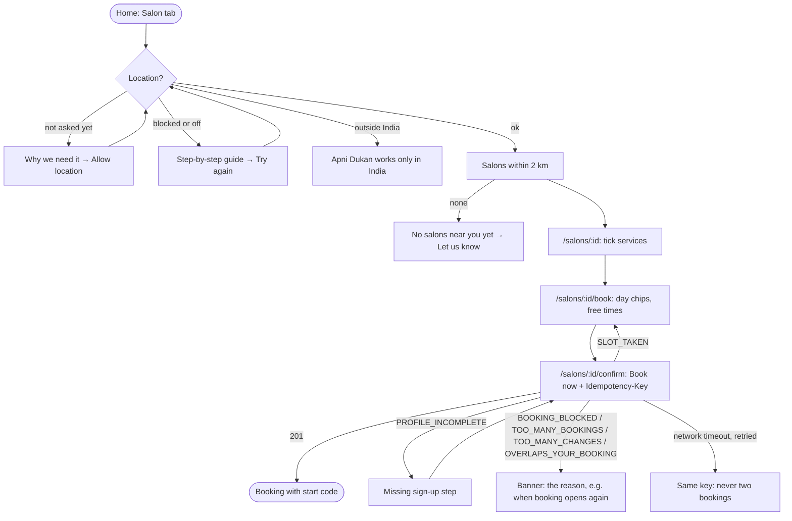
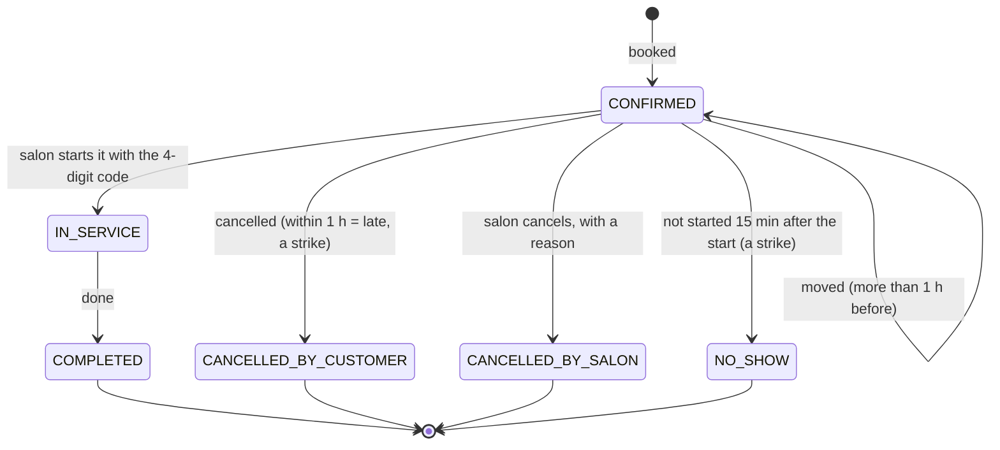
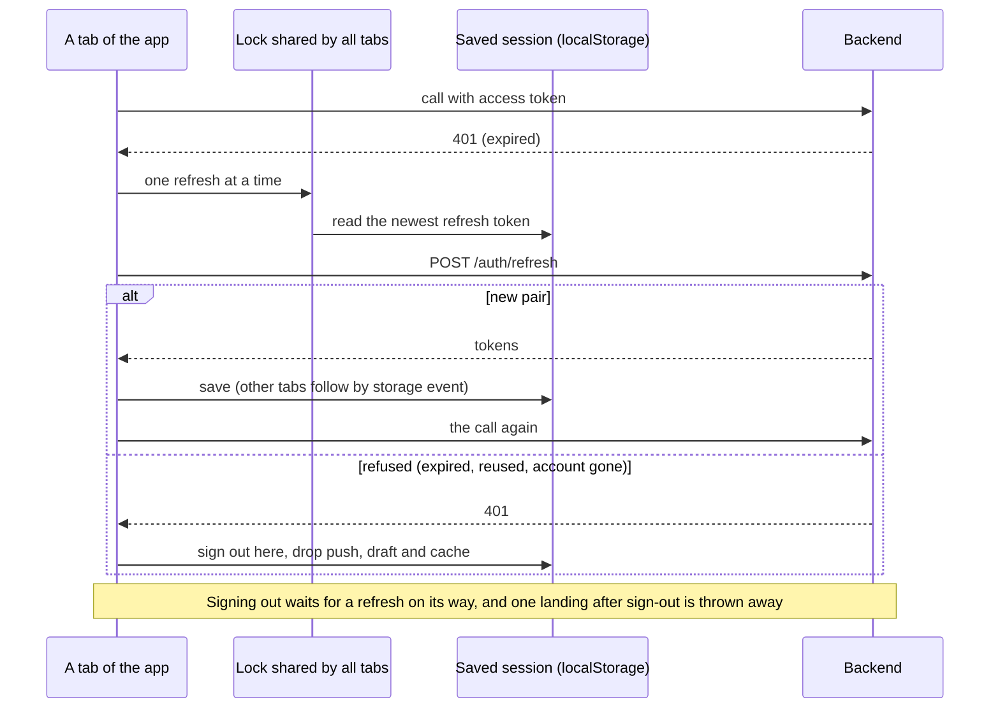

# Apni Dukan — customer app

The app customers use to find a salon near them and book a time. It is a mobile-first web app (it can be
added to the phone's home screen) and talks only to [apni-dukan-backend](https://github.com/Premanshu-jha/apni-dukan-backend).

Home has category tabs like Swiggy's Food and Instamart: **Salon** works today; **Kirana** and **Services** show
"Coming soon". Shop owners and the field team use separate apps (partner and admin), not this one.

## Run it on your laptop

You need Node 22 and the backend running (on your laptop at `http://localhost:8080`, or on Railway).

```bash
npm install
cp .env.example .env.local     # then edit the two values
npm run dev                    # http://localhost:5173
```

| Setting | What it is | Example |
| --- | --- | --- |
| `VITE_API_URL` | The backend's address, no trailing slash | `http://localhost:8080` or `https://apni-dukan-backend-production.up.railway.app` |
| `VITE_TURNSTILE_SITE_KEY` | Cloudflare Turnstile **site** key (public). Leave empty when the backend has no `TURNSTILE_SECRET_KEY` | `0x4AAAAAAA…` |
| `VITE_SUPPORT_EMAIL` | Where customers write for help (Profile, and "No salons near you yet"). Default `support@apnidukan.in` | `support@apnidukan.in` |

All are public values baked into the page at build time. No secret ever goes in this app.

The backend must allow this app's address in `CORS_ALLOWED_ORIGINS` (it already allows `http://localhost:5173`).

| Command | Does |
| --- | --- |
| `npm run dev` | Dev server with hot reload |
| `npm run typecheck` | TypeScript check |
| `npm run lint` | oxlint |
| `npm test` | Unit tests (Vitest) |
| `npm run e2e` | End-to-end tests (Playwright): a real browser drives the app against a fake backend |
| `npm run build` | Type-check and production build into `dist/` |

CI runs type-check, lint, unit tests, build, the end-to-end tests and a gitleaks secret scan on every pull request.

### Tests

Every situation a customer can run into is listed in [`docs/scenarios.md`](docs/scenarios.md): the journey, what
the backend answers, what the screen shows, and which test proves it. New work adds or updates rows there, and
reviews walk the list against the code.

- **Unit tests** (`src/**/*.test.ts`): India time, money, phone numbers, the profile steps, the booking draft, and
  the API client (one shared refresh, the newest saved token, a refresh landing after sign-out, busy retry, error
  codes).
- **End-to-end tests** (`e2e/`): Playwright on a phone-sized Chromium, against `e2e/mockApi.ts`, a fake backend
  whose answers follow the backend's records and error codes (`.env.e2e` points the app at it). Journeys: sign-up
  to booking, blocked location, a time taken by someone else, move and cancel, a late cancel, messages, sign-out
  and the next person, two tabs sharing one session, a failed "sign out everywhere", a removed service in a saved
  draft. A failed run in CI keeps its traces as an artifact.

## Screens

Everything needs sign-in, because the backend's salon endpoints need a signed-in session. The guards in
`src/app/guards.tsx` send people to the right step.

| Route | Screen | Backend calls (`/api/v1/…`) |
| --- | --- | --- |
| `/signin` | Mobile number + robot check | `POST auth/otp/send` |
| `/signin/code` | 6-digit SMS code, resend after 30 s | `POST auth/otp/verify` |
| `/signin/recover` | Lost phone: email + new number, a code to each | `POST auth/recover/start`, `auth/recover/complete` |
| `/welcome/email` | Step 2 of 3: email and its code | `POST auth/email/send-code`, `auth/email/verify` |
| `/welcome/name` | Step 3 of 3, last: "What should we call you?" | `PATCH auth/me` |
| `/` | Home: category tabs; Salon tab = location, then salons within 2 km, 30 at a time ("Show more salons") | `GET salons?lat&lng[&afterDistance&afterId]` |
| `/salons/:id` | Salon: photo, address, services to tick, opening hours | `GET salons/{id}`, `salons/{id}/services` |
| `/salons/:id/book` | Day chips (7 days) and free times | `GET salons/{id}/availability?services&date` |
| `/salons/:id/confirm` | Summary and Book now | `POST bookings` (with `Idempotency-Key`) |
| `/bookings` | Upcoming / Past | `GET me/bookings?when=` |
| `/bookings/:id` | Start code, arrive-by time, services, Move, Cancel, notifications offer | `GET bookings/{id}`, `POST bookings/{id}/cancel` |
| `/bookings/:id/move` | New day and time | `POST bookings/{id}/reschedule` |
| `/notifications` | Messages: newest first, unread marked, tap to open the booking, Mark all read, Show older | `GET me/notifications?app=customer`, `POST me/notifications/read` |
| `/profile` | Name, mobile, email, notifications switch, help email, sign out, sign out everywhere | `PATCH auth/me`, `POST auth/logout`, `auth/logout-all` |
| `/profile/email` | Change email (SMS code first when the old email is verified) | `POST auth/email/change-phone-code`, `auth/email/send-code`, `auth/email/verify` |
| `/profile/delete` | Delete account with an SMS code | `POST auth/me/delete-code`, `auth/me/delete` |

## Flows

### Sign-up and sign-in

Who goes where: the route guards (`src/app/guards.tsx`) and `nextAfterSignIn` (`src/features/auth/flow.ts`).


### Finding a salon and booking

`LocationGate`, `SalonList`, `SalonPage`, `BookTime`, `ConfirmBooking`. Every backend answer on Book has its own
branch; the Idempotency-Key in the draft means a retried tap never books twice.



### A booking's life

What the customer sees on `/bookings/:id` (`BookingDetail`). Move is offered only while `canMove` is true (more than
1 hour to go and the salon taking changes); Cancel while `canChange` is true.



### Staying signed in (several tabs)

`src/api/client.ts` and `src/store/session.ts`.



## How it works

### Folders

```
src/
  app/          routes (App.tsx), guards, shell with the bottom bar
  api/          client.ts (fetch, refresh, retries), errors.ts, types.ts, one file per backend area
  features/     auth, home, location, salon, bookings, profile — one folder per part of the app
  components/   Button, Field, Card, Banner, Sheet, Chip, CodeInput, Turnstile
  store/        session, location, booking draft (Zustand)
  lib/          India time, money, phone, storage, device name, config
public/         sw.js (push notifications), manifest, icon
```

### Sign-in and the session

- Sign-up order: phone code → email code → name (asked last). `missingSteps()` in `store/session.ts` decides what
  is still needed; the backend refuses bookings with `403 PROFILE_INCOMPLETE` until all three are done.
- The **access token** (15 minutes) is kept in memory only. The **refresh token** and the user are saved in
  `localStorage` (`ad.session`) so a reload keeps the person signed in.
- `api/client.ts`: any 401 → one refresh → the request again. Requests that hit an expired token at the same time
  share one refresh. A refused refresh signs the person out; a network blip doesn't.
- `SERVICE_BUSY` (503) → wait `Retry-After` (at most 5 s) and try once more, only for reads and for calls with an
  `Idempotency-Key`.
- **Several tabs:** all tabs share the saved refresh token. A refresh takes a lock shared by the tabs
  (`navigator.locks`) and reads the newest saved token inside it, and each tab follows the others through `storage`
  events. Without this, a second tab would send an already-swapped token, which the backend treats as theft and
  answers by signing the person out everywhere (`REFRESH_TOKEN_REUSED`).
- **Signing out while a refresh is on its way:** sign-out waits for it, and a refresh that still lands afterwards
  is thrown away (its new token is signed out too), so the session never comes back by itself.
- **When the backend ends the session** (expired, signed out everywhere, account deleted on another device), this
  browser drops its notification subscription, the booking draft, cached data and the saved return path.
- A device name ("Chrome on Android · 4f2a") is made once and sent with sign-in and refresh.
- Known trade-off for now: a refresh token in `localStorage` can be read by a script injected into the page. Before
  launch it can move to an HttpOnly cookie (needs a small backend change).

### Location and nearby salons

- Location comes from the phone only; there is no pincode option. Before the browser's Allow/Block prompt the app
  explains why. If location is blocked or off, a guide shows the steps for Android, iPhone or a computer.
- The location is saved on the phone (`ad.location`) and shown as "Near your current location · ±30 m · Update".
- Accuracy worse than 1 km (usual on laptops) shows a warning that results may be off.
- The backend returns approved salons within 2 km, nearest first, 30 at a time (found by a map index, so a dense
  city is as fast as a quiet one). "Show more salons" asks for the next 30 after the last one's distance and id,
  until a shorter page comes back. None → "No salons near you yet" with a "Let us know" email link (to
  `VITE_SUPPORT_EMAIL`).

### Booking

- The draft (salon, services, day, time, idempotency key) is saved on the phone (`ad.draft`), so a reload keeps it.
- Changing the services clears the chosen time (a different length of booking needs a different slot).
- Book sends an `Idempotency-Key`; a retried tap never makes two bookings. A new key is made after any final answer.
- A draft saved on an earlier day keeps its services but drops a day or time that has passed.
- `IDEMPOTENCY_KEY_REUSED` (an earlier try whose answer never arrived may have booked) → "Check My bookings", and a
  new key for the next try.
- `SLOT_TAKEN` (booking or moving) refreshes that salon's free times, then → back to the time screen with "Someone just booked that time". `TOO_MANY_BOOKINGS` (2 upcoming) links
  to My bookings. Other errors show the backend's own message.
- All times are shown in India time (`lib/ist.ts`), whatever zone the phone is set to.
- Move is hidden within 1 hour of the start (`canMove` from the backend). Cancelling within 1 hour warns that it
  counts as a late cancel.

### Notifications

- `public/sw.js` shows the backend's Web Push messages (`{type, title, body, url}`) and opens the app on tap, only on
  this app's own pages.
- Offered once after a booking, and as a switch on Profile. Needs the backend's VAPID keys; without them the app says
  notifications aren't set up. On iPhone, notifications work only after "Add to Home Screen".
- Signing out or deleting the account turns them off for this browser first. After every sign-in the browser's
  subscription is sent again, which moves it to the person now signed in (one browser never gets another
  person's messages).
- **In-app messages:** the bell on Home shows the unread count (checked every minute and when the app comes back
  into view). The Messages screen lists the same messages the backend sends as notifications, so nothing is lost
  if notifications are blocked. Tapping one marks it read and opens its booking (only this app's own pages).
  When a push arrives while the app is open, the service worker tells the page, which refreshes the bell and the
  bookings at once. Needs the backend's `GET /me/notifications` (backend PR #22).
- An open booking refreshes every 30 s while it can still change (booked or in progress), then stops.

## Deploying

Any static host works (Vercel or Cloudflare Pages, free tier). Build command `npm run build`, output folder `dist`,
and set `VITE_API_URL` (and `VITE_TURNSTILE_SITE_KEY` in production) in the host's settings. All routes must serve
`index.html` (single-page app). Then add the site's address to the backend's `CORS_ALLOWED_ORIGINS`.

## Changelog

### 0.5.0 — 2026-11-06

- ETags: the API client keeps the last answer to each read in memory only (per person, at most 200 addresses), sends
  its ETag as `If-None-Match` and shows the kept data on a 304, so a booking, the bell or a list re-read with nothing
  changed downloads nothing. Answers stay `no-store` (a shared phone keeps nothing after sign-out); the memory is
  forgotten on sign-out, when the session ends and when another person signs in. A 304 is never an error and never
  retried. Needs the backend's scale PR (#31).
- A 304 for which nothing is kept (a cache or proxy on the way, or the person signed out or changed while the
  read was on its way) is asked once more without `If-None-Match` and past any cache, instead of becoming an error.
- Tests: the fake backend answers ETags and 304s like the real one; an end-to-end refresh answered 304; unit tests
  of the ETag memory.

### 0.4.0 — 2026-11-06

- Salons are listed within 2 km (was 5 km), 30 at a time with "Show more salons", so a dense area with hundreds of
  salons loads quickly. Needs the backend's scale PR (pages with `afterDistance` and `afterId`).
- "N salons within 2 km, nearest first" (no longer the wrong "within 5 km" count when the list was cut at 50).
- A failed "Show more salons" keeps the salons already shown and says so (offline is told at once); the button stays
  focusable while loading, focus moves to the first new salon, and the count is announced.
- Messages: "99+ unread" once there are more than 99 (the backend now counts up to 100).
- Tests: the fake backend pages like the real one and caps unread at 100; end-to-end journeys for a dense area,
  exactly 30 salons, a failed page and 99+ unread.

### 0.3.0 — 2026-11-04

- Flow diagrams in this README: sign-up and sign-in, booking, a booking's life, staying signed in.

Second review round (four independent reviews: customer app, backend, backend inbox, contract between them).

- "Sign out on all devices" never fails quietly: if the backend can't be reached, this device stays signed in and
  says the other devices are still signed in.
- A service the salon removed is dropped from a saved draft (it used to be sent with every booking and fail).
- Confirm shows an error with retry instead of an empty ₹0 summary when loading fails.
- `BOOKING_BLOCKED` says when online booking opens again; `TOO_MANY_CHANGES` ends the attempt (new key).
- `PROFILE_INCOMPLETE` refreshes the profile and comes back to Confirm after the missing step.
- `CAPTCHA_REQUIRED` resets the robot check like `CAPTCHA_FAILED`.
- Change email: a wrong or used-up SMS code goes back to the SMS step instead of leaving the person stuck.
- A complete user is sent on from the sign-up steps; resend buttons can't fire twice and email has a 30 s wait.
- A saved location older than 30 minutes is checked again (quietly, when allowed); a failed Update says so; the
  location is forgotten on sign-out.
- A browser subscription the backend didn't accept is dropped, so the switch never says On wrongly; iPhone users
  see how to get notifications (Add to Home Screen).
- Dialogs: focus moves in, Tab stays inside, Escape closes, focus returns.
- Money with paise shows two decimals (₹99.50); the service worker opens a fresh window when it can't navigate.
- Leaving Confirm after a taken time no longer bounces to the salon page (found by the new end-to-end tests).
- End-to-end tests in CI.

Scenario audit (146 customer scenarios, `docs/scenarios.md`) and its fixes:

- Outside India: "Apni Dukan works only in India" instead of "Some fields are not valid".
- Confirm sends exactly the services it shows (a removed one is never sent).
- Moving: the free times count the booking's own time as free (`moving=`), so a move by a few minutes is offered.
- When Move isn't offered more than an hour ahead, the reason given is the salon not taking changes.
- `OVERLAPS_YOUR_BOOKING` (one person, two bookings at once) ends the attempt with the backend's message.
- 17 end-to-end journeys now, including: profile incomplete at booking, a move losing its time, a salon taken
  off the app, no salons nearby, outside India, expired and too-many-tries codes, signing out in one of two tabs.

### 0.2.0 — 2026-11-04

- In-app messages: bell with the unread count on Home, Messages screen, mark one or all read, older pages.
- A push that arrives while the app is open refreshes the bell and the bookings.
- Profile: a help card with the support email (`VITE_SUPPORT_EMAIL`).
- The booking screen stops refreshing once the booking is finished or cancelled.
- Wording: the email step no longer promises receipts (none are sent); "No free times" covers closed days too.
- Review fixes: several tabs no longer sign the person out everywhere; signing out during a refresh stays signed
  out; a session ended by the backend drops this browser's notifications, draft and return path; notifications are
  claimed for whoever signs in; `IDEMPOTENCY_KEY_REUSED` is handled; a taken time disappears at once; a saved draft
  drops past days; the next person to sign in starts at Home, not on the previous person's page.
- Tests: 24 (added: the newest saved refresh token is used, a late refresh after sign-out, the stale draft).

### 0.1.0 — 2026-11-04

- First version of the customer app: sign-in (phone, email, name), account recovery, location with a guide when it
  is off, nearby salons, salon page, time picker, booking, My bookings, booking detail with start code, move,
  cancel, profile, change email, delete account, push notifications, dark theme.
- Unit tests for India time, money, phone numbers, the session steps, the API client (shared refresh, busy retry,
  error codes) and the sign-in form.
- CI: type-check, lint, tests, build, gitleaks (with read access to pull requests, which the scan needs).
